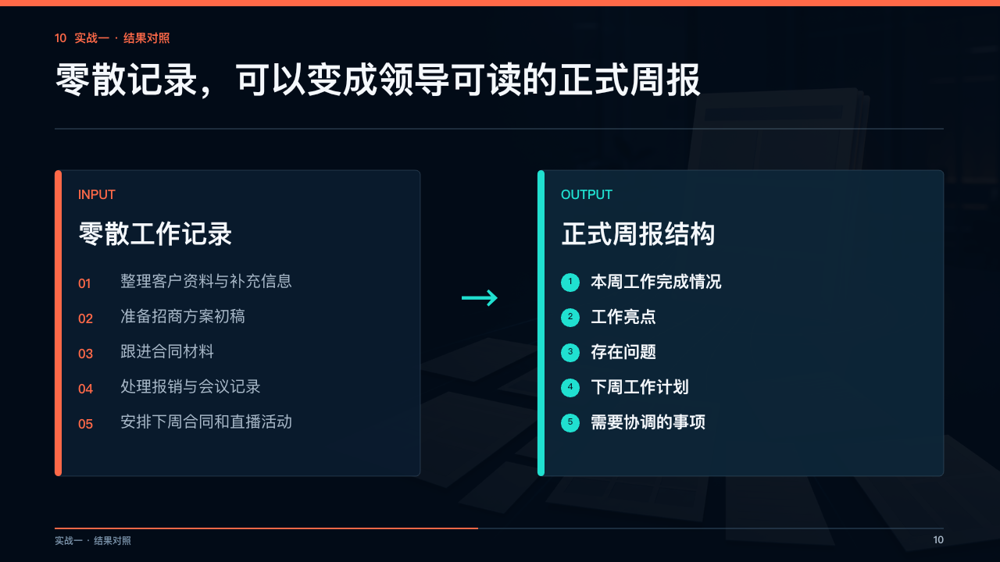
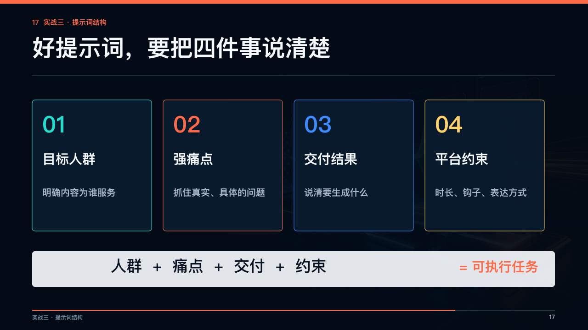

# 大琰PPT Skill

**当前版本：v1.0.1**

一个面向 Codex 的证据驱动型专业 PPT 生产与持续学习技能：从 Word、PDF、Excel、图片或既有 PPT 中提取可核验材料，识别行业与场景，组织证据和叙事，生成可编辑演示文稿，并完成逐页 QA 与交付后经验沉淀。

它不是单一模板，也不是“把文字自动排成几页”的脚本。技能固定的是事实边界、场景判断、证据链和验收门禁；配色、版式、图片语言和动效会根据行业、受众、品牌和观看方式变化。

## 适用场景

- 政务、企业、科技、制造、教育、金融、咨询等行业汇报
- 项目立项、方案提案、产品发布、客户沟通、培训课件、路演、研究和验收
- 用户只提供资料包，希望减少重复澄清并直接进入可验证制作
- 需要把本次交付中已证实的经验，匿名沉淀为后续可查询的候选规则

## 核心能力

- **先分类后制作**：按 `I01-I15 行业 × H01-H12 横向应用 × 受众 × 阶段 × 观看方式` 路由生产策略。
- **数据零编造**：关键数字回到原始材料、工作表单元格或明确公式；冲突和缺证据状态会被保留。
- **证据架构**：从材料建立事实账本、主张与来源映射，再生成 `production-manifest.yaml` 和 `deck-plan.json`。
- **可编辑交付**：配合 Presentations 技能与 `@oai/artifact-tool` 生成 PPTX，不把截图或静态图片当成可编辑成品。
- **视觉与动效约束**：页面保持一个主结论和一个主视觉焦点；动态必须有静态首帧降级方案。
- **逐页 QA**：检查溢出、遮挡、数据口径、来源、文件完整性、媒体嵌入和交付评分。
- **证据化学习**：只有完成交付、通过 QA 且达到门槛的经验才会记录为低权重 `candidate`；沉默不会被当作验收。

## 使用方式

### 安装

将仓库克隆到 Codex 技能目录：

```bash
git clone https://github.com/jyan5334-lab/dayan-ppt-skill.git ~/.codex/skills/dayan-ppt
```

如果此前是通过本仓库克隆安装，进入目录升级：

```bash
cd ~/.codex/skills/dayan-ppt
git pull --ff-only origin main
```

安装或升级后，在 Codex 中直接调用：

```text
请使用 $dayan-ppt，根据我提供的资料识别行业与场景，生成可编辑 PPT，并完成数据校验、逐页 QA 和交付说明。
```

建议同时提供：

1. 主要材料：Word、PDF、Excel、图片、既有 PPT 或品牌模板。
2. 受众和最终行动：谁看、需要作出什么判断或决定。
3. 输出约束：页数、比例、现场/线上/自读、是否需要动态和交付格式。

## 标准生产链路

```text
材料盘点
  -> 全量读取工作簿/文档并建立事实账本
  -> I×H 分类与受众/阶段判断
  -> production-manifest.yaml
  -> 主张-证据架构与 deck-plan.json
  -> 页面、图表、视觉素材和动效设计
  -> PPTX 制作与逐页渲染
  -> 溢出/来源/口径/完整性/放映 QA
  -> 交付与匿名候选经验记录
```

## 示例截图

以下截图来自本地已制作的 GPT + Codex 培训演示文稿，用于展示技能可支持的叙事、输入/输出对照和提示词结构页面。截图只展示版式与信息组织能力，不是通用模板，也不构成任何项目事实证据。

### 封面与主题定位


### 输入到正式周报的结果对照



### 把提示词拆成可执行任务



更多截图说明、来源边界和复用限制见 [examples/screenshots/README.md](examples/screenshots/README.md)。

## 验证命令

以下命令均在本仓库内提供，参数使用实际项目文件替换：

```bash
# 审计一个或多个工作簿，生成事实来源账本
python scripts/audit_workbooks.py <workbook...> --output <source-ledger.json>

# 校验关键数字与来源单元格
python scripts/verify_workbook_claims.py <fact-claims.json>

# 制作前校验页面计划
node scripts/validate-deck-plan.mjs <deck-plan.json>

# 制作前校验视觉素材计划
node scripts/validate-visual-asset-plan.mjs <visual-asset-plan.json>

# 运行持续学习注册表回归
python scripts/test_learning_registry.py
```

命令的输入契约、状态码和失败处理见 [docs/使用与验收说明.md](docs/使用与验收说明.md)。

## 仓库结构

```text
.
├── SKILL.md                         # 技能主契约与完整生产流程
├── agents/openai.yaml               # Codex 界面元数据与默认提示
├── references/                      # 行业、场景、页面、图表、动效和 QA 规则
├── scripts/                         # 工作簿审计、事实校验、计划校验和学习注册表
├── assets/                          # production manifest、deck plan 等模板
├── examples/screenshots/            # 可公开展示的示例截图
├── docs/使用与验收说明.md             # 入口、权限、异常和验收清单
├── VERSION                           # 当前发布版本
└── CHANGELOG.md                      # 按版本记录的真实变更
```

## 版本规则

本仓库使用语义化版本：

- `MAJOR`：存在不兼容的技能契约、输入输出或工作流变化。
- `MINOR`：新增向后兼容的能力、脚本、规则库或模板。
- `PATCH`：修正文档、元数据、校验问题或其他不改变核心行为的更新。

版本历史见 [CHANGELOG.md](CHANGELOG.md)。仓库版本以 `VERSION`、Git 标签和 GitHub Release 三者一致为准。

## 边界与限制

- 本仓库是本地 Codex Skill，不提供后端服务、数据库或 HTTP API；脚本通过文件和 JSON/YAML 契约工作。
- 生成 PPT 仍需要本机可用的 Presentations 能力和相应运行环境；仓库中的校验器不会替代实际渲染与逐页检查。
- Image 2 只用于可组合的概念/氛围位图，不能替代真实地点、产品、人物、客户、工程成果或数据证据。
- 公开仓库不应提交客户原始材料、未脱敏截图、密钥、令牌、绝对路径或临时产物。
- “页面完成”“校验器通过”和“已可生产交付”是不同状态，必须按验收清单分别报告。

## 相关说明

- [完整技能契约](SKILL.md)
- [使用与验收说明](docs/使用与验收说明.md)
- [示例截图说明](examples/screenshots/README.md)
- [版本更新日志](CHANGELOG.md)
